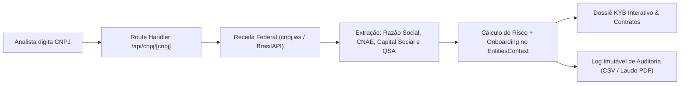

<div align="center">

# 🛡️ KybGuard

**Mesa de Homologação B2B (KYB — Know Your Business), Due Diligence Societária integrada à Receita Federal e Trilha de Auditoria Imutável**

[](https://nextjs.org/)
[](https://react.dev/)
[](https://www.typescriptlang.org/)
[](https://tailwindcss.com/)
[](#)

</div>

---

## 🎯 A Premissa

> *"Nenhuma empresa deve fechar contrato ou liberar pagamentos para um fornecedor/parceiro PJ no escuro."*

Antes de homologar um fornecedor estratégico, aprovar limite de crédito B2B ou assinar um aditivo contratual, a área de Compliance precisa validar quatro pilares:
1. **Situação Cadastral Real:** O CNPJ está **ATIVO** na Receita Federal ou foi declarado Inapto/Baixado?
2. **Quadro Societário (QSA) & Capital Social:** Quem são os sócios/administradores reais e o capital social é compatível com o porte do contrato?
3. **Coerência de Objeto Social (CNAE):** A atividade econômica principal condiz com o serviço prestado?
4. **Rastreabilidade Regulatória:** Toda aprovação, bloqueio ou vinculação contratual precisa ficar gravada em uma trilha de auditoria imutável (`oldValue -> newValue`) pronta para fiscalização externa.

O **KybGuard** resolve esse fluxo ponta a ponta em uma interface de alta densidade informacional (*Institutional Trust UI*).

---

## ✨ Funcionalidades Principais

- **🔍 Onboarding KYB Automático via CNPJ (`/api/cnpj/[cnpj]`):**
  - Consulta em tempo real com *fallback* inteligente (`publica.cnpj.ws` → `BrasilAPI`).
  - Extração automática de **Razão Social**, **Nome Fantasia**, **Situação Cadastral**, **CNAE Principal**, **Município/UF**, **Capital Social (R\$)**, **Porte** e **Quadro de Sócios e Administradores (QSA)**.
  - Cálculo automático de **Score de Risco (0–100)** baseado na situação cadastral junto à Receita Federal.
- **🗂️ Dossiê Societário Interativo (`KycProfileCard` & `EntityDataTable`):**
  - Seleção instantânea de qualquer empresa na tabela para inspecionar seu dossiê completo, QSA, capital social e checagens de listas restritivas (CEIS/CNEP, OFAC/ONU, Trabalho Análogo ao Escravo/MTE).
  - Decisões em 1 clique (**Homologar Entidade**, **Bloquear Preventivamente** ou **Remover**) com atualização imediata dos KPIs.
- **📑 Gestão de Contratos B2B (`/contratos`):**
  - Cadastro de contratos, NDAs, DPAs (LGPD) e aditivos vinculados diretamente às empresas monitoradas na base.
  - Monitoramento de vigência, valores em BRL e alertas de vencimento.
- **🔐 Trilha de Auditoria Imutável (`/auditoria`):**
  - Cada ação executada no sistema (onboarding de CNPJ, mudança de status KYB, criação de contrato ou exclusão) gera automaticamente um evento rastreável com **ID de transação**, **Ator**, **Timestamp** e **Diff de campos (`Valor Anterior → Novo Valor`)**.
  - Exportação instantânea em **CSV** (compatível com Excel UTF-8 BOM) e geração de **Laudo Oficial de Auditoria em PDF**.

---

## 🏗️ Arquitetura do Fluxo KYB



---

## 🚀 Como Executar Localmente

### Pré-requisitos
- **Node.js 20+** e `npm`

### Passo a passo

```bash
# 1. Clone o repositório
git clone https://github.com/gabzieg/KybGuard.git
cd KybGuard

# 2. Instale as dependências
npm install

# 3. Inicie o servidor de desenvolvimento
npm run dev
```

Acesse **`http://localhost:3000`** no navegador.

> 💡 **Dica de Teste Rápido:** Clique em **"Nova Entidade (KYC)"** no canto superior direito e digite qualquer CNPJ real (ex.: `00.000.000/0001-91` do Banco do Brasil ou `33.000.167/0001-01` da Petrobras) para ver o preenchimento automático da Receita Federal, o Quadro Societário (QSA) e o registro automático na aba **Auditoria**.

---

## 🛠️ Stack Tecnológica

- **Framework:** Next.js 16 (App Router) + React 19
- **Linguagem:** TypeScript 5 (Strict Mode)
- **Estilização & UI:** Tailwind CSS v4, Radix UI Primitives, Lucide Icons, Dark/Light Theme (`next-themes`)
- **Tabelas & Formulários:** TanStack Table v8, React Hook Form + Zod
- **Integração Receita Federal:** Next.js Server Route com *failover* automático entre `publica.cnpj.ws` e `brasilapi.com.br`

---

## 📄 Licença

Distribuído sob a licença MIT.
